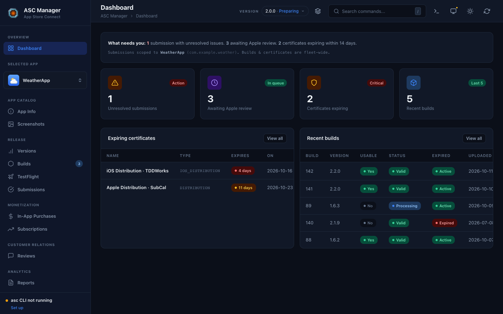

# ASC Command Center

[](https://github.com/tddworks/asc-command-center/actions/workflows/test.yml)
[](https://codecov.io/gh/tddworks/asc-command-center)
[](https://github.com/tddworks/asc-command-center/actions/workflows/deploy.yml)
[](LICENSE)

A React 19 + Vite SPA over the [`asc`](https://github.com/tddworks/asc-cli) App Store Connect CLI. Browse apps, manage versions, edit metadata, manage TestFlight, and submit to App Store review — all driven by the local `asc web-server`.

Use it hosted at **[cc.asccli.app](https://cc.asccli.app)** or run it yourself. Either way it talks only to the `asc web-server` on your own machine; your API keys never leave it.



## Quickstart

Needs Node 22.12 or later.

```bash
# 1. Install asc CLI
brew install tddworks/tap/asccli

# 2. Start the local backend
asc web-server

# 3. Run the UI
npm install
npm run dev
```

The dev server proxies `/api/*` to `http://localhost:8420`. On boot the UI probes `/api/v1`; if asc isn't running you get a guided install/start sheet from the sidebar.

No App Store Connect account? Skip steps 1–2: without a backend the UI starts in **mock mode** with built-in sample apps, so you can explore and develop against it straight away.

## Scripts

| Script | What it does |
|---|---|
| `npm run dev` | Vite dev server on port 5173 |
| `npm run build` | Type-check + production build to `dist/` |
| `npm run preview` | Serve the built bundle |
| `npm test` | Vitest suite (jsdom env) |
| `npm run test:watch` | Vitest watch mode |
| `npm run test:coverage` | Vitest with v8 coverage → `coverage/` |

## Architecture

Cake-slice features grouped by bounded context (`app-catalog`, `release`, `monetization`, `customer-relations`, `analytics`, `developer-tools`, `extensibility`). Each slice cuts through six layers: domain class (mutable + observable via MobX), repository port, root aggregate, application hook/instance, REST + mock infrastructure, and UI components. Chicago-school state-based TDD over rich domain classes — see [`CLAUDE.md`](CLAUDE.md) and [`docs/features/README.md`](docs/features/README.md).

## Coverage

Coverage is collected by `@vitest/coverage-v8` and uploaded to Codecov on every push and PR. The HTML report lives at `coverage/index.html` after `npm run test:coverage` for local drilling.

## Contributing

Issues and pull requests are welcome — start with [CONTRIBUTING.md](CONTRIBUTING.md). Tests come first. Please follow the [Code of Conduct](CODE_OF_CONDUCT.md), and report security issues privately as described in [SECURITY.md](SECURITY.md).

## Private API notice

Some features — the **Iris** page and parts of the in-app purchase and subscription submission flow — rely on endpoints the `asc` CLI reaches through App Store Connect's private web API ("iris"), not the public [App Store Connect API](https://developer.apple.com/documentation/appstoreconnectapi). Apple doesn't document or support those endpoints; they can change or stop working at any time, and using them is at your own risk under your agreements with Apple.

## License

Licensed under the [Apache License, Version 2.0](LICENSE). See [`NOTICE`](NOTICE) for attribution.

## Disclaimer

ASC Command Center is an independent project. It is not affiliated with, endorsed by, or sponsored by Apple Inc. Apple, App Store, App Store Connect, TestFlight, Xcode and Xcode Cloud are trademarks of Apple Inc., registered in the U.S. and other countries.
